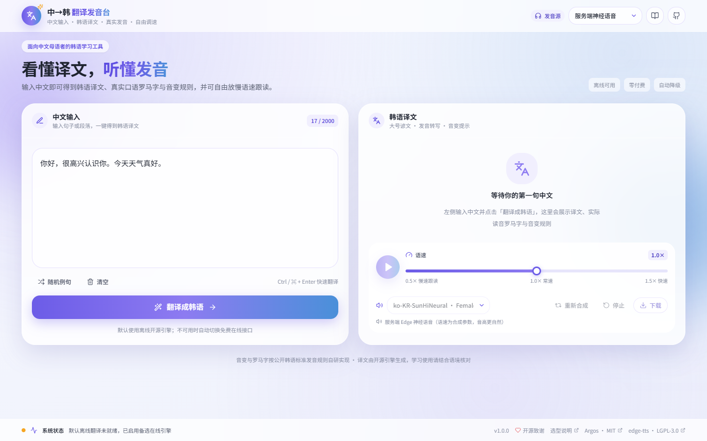
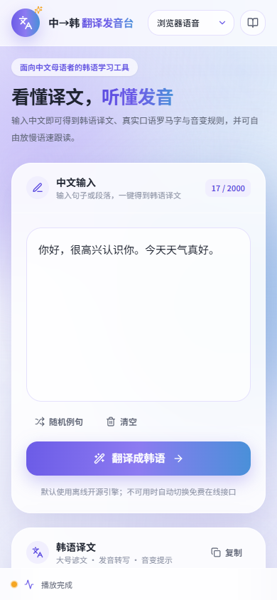

# 中→韩 翻译发音台

输入中文，得到**韩语译文 + 真实发音罗马字 + 音变提示**，并可自由调节语速（0.5×~1.5×）跟读。
面向中文母语者的轻量学习工具：**零付费、零必需密钥、可部署到服务器供多人访问**。

> 仓库选型、能力对比、许可证核验与风险清单见 [docs/REPO_SELECTION.md](docs/REPO_SELECTION.md)；
> 克隆的第三方仓库登记见 [vendor/README.md](vendor/README.md)。

| 桌面端工作台 | 移动端 |
| --- | --- |
|  |  |

---

## 功能

| 功能 | 说明 |
| --- | --- |
| 中译韩 | 输入句子或段落，返回韩语译文；长文本自动分句；支持示例填入、清空、复制、Ctrl/⌘+Enter |
| 朗读与语速 | 服务端 Edge 神经语音（女声/男声）或浏览器语音；0.5× 慢速跟读到 1.5× 快速；播放/停止/重播/下载 MP3 |
| 学习性展示 | 修订罗马字转写、音变后实际读音高亮、连音/鼻音化/紧音化等规则悬浮讲解、敬语语体判断 |
| 自动降级 | 翻译按 `argos → libre → free` 依次尝试；服务端发音不可用时自动切到浏览器 Web Speech，页面给出明确提示 |
| 可部署 | 同源托管前端静态产物（无 CORS）、健康检查、进程内 LRU 缓存、Docker Compose 一键启动 |

## 技术栈

- **前端**：React 18 + TypeScript + Vite 5 + Tailwind CSS 3.4（自研轻量 UI 组件，未引入 shadcn/Radix）
- **后端**：Python 3.11 + FastAPI + Uvicorn，单进程即可运行
- **翻译**：Argos Translate（MIT，离线，默认）→ LibreTranslate（AGPL，HTTP 边界）→ MyMemory 匿名免费接口（兜底）
- **发音**：edge-tts（LGPL-3.0，服务端主链路）→ 浏览器 Web Speech API（兜底）；MeloTTS 为默认关闭的可选离线档
- **缓存**：进程内线程安全 LRU，无数据库、无消息队列

## 快速开始

### 方式 0：Windows 双击启动（最简单）

直接双击根目录下的 **`打开平台.bat`**：它会自动检查 `.venv` 与前端产物、复用已运行的服务、
必要时启动后端并等待健康检查通过，最后用默认浏览器打开 `http://127.0.0.1:8000`。
首次运行若缺依赖或前端未构建，会自动安装 / 构建。

- 服务运行在**最小化的「中→韩 翻译发音台 - 服务」窗口**中，关闭该窗口即停止服务。
- 重复双击不会重复启动，只会再次打开网页。
- 疑难排查可设置环境变量 `KO_SKIP_BROWSER=1` 后从命令行运行，只启动服务不弹浏览器。

### 方式 A：Docker（推荐部署到服务器，最省事）

```bash
cp .env.example .env
docker compose up -d --build
# 浏览器打开 http://<服务器 IP>:8000
```

镜像固定 Python 3.11（避开 `ctranslate2` 在 3.13 上可能缺 wheel 的问题），
默认安装核心依赖 + `edge-tts`，**不需要任何 API key 即可翻译和发音**。
健康检查：`curl http://localhost:8000/api/health`。

### 方式 B：本地开发（Windows / macOS / Linux）

**1. 启动后端**

```powershell
# Windows PowerShell（自动建 .venv、装核心依赖、启动 8000 端口）
powershell -ExecutionPolicy Bypass -File server/scripts/start_backend.ps1

# 想启用离线翻译 + 服务端神经语音：
$env:INSTALL_OPTIONAL = "1"
powershell -ExecutionPolicy Bypass -File server/scripts/start_backend.ps1
```

等价的手工方式：

```bash
python -m venv .venv
.venv/Scripts/pip install -r server/requirements.txt   # Windows
.venv/Scripts/pip install edge-tts==7.3.1              # 可选但推荐
set PYTHONPATH=server
.venv/Scripts/python -m uvicorn app.main:app --host 0.0.0.0 --port 8000 --app-dir server
```

**2. 构建前端**

```bash
cd web
npm install
npm run build        # 产物输出到 web/dist，由后端同源托管
```

开发模式（热更新 + 自动代理 `/api` 到 8000）：

```bash
cd web && npm run dev   # http://localhost:5173
```

**3. 验证**

```bash
python server/scripts/smoke_test.py     # 结果写入 server/scripts/smoke_result.json
```

### 启用完全离线翻译（可选）

```bash
pip install -r server/requirements-optional.txt   # Python 3.10/3.11 推荐
python server/scripts/setup_argos.py              # 下载 zh→en + en→ko 语言包（需联网一次）
python server/scripts/setup_argos.py --check      # 验证 zh→ko 路径与试译
```

装好后 `zh→ko` 会由 Argos 自动经英语中转合成（pivot），译文标为「经英语中转」。
内网服务器可在联网机器预装后把语言包目录整体拷贝到 `ARGOS_PACKAGES_DIR`。

## 部署到服务器

1. 开放 8000 端口（或改 `APP_PORT`），`docker compose up -d --build`。
2. 建议用 Nginx 反向代理并配 HTTPS（同源部署，无需额外 CORS）：

```nginx
server {
    listen 80;
    server_name your-domain.com;
    client_max_body_size 1m;
    location / {
        proxy_pass http://127.0.0.1:8000;
        proxy_set_header Host $host;
        proxy_set_header X-Real-IP $remote_addr;
        proxy_read_timeout 60s;
    }
}
```

3. 若服务器无法访问境外端点（`speech.platform.bing.com`、MyMemory），
   平台会自动降级：**翻译**可用自托管 LibreTranslate / Argos 离线包，**发音**自动切浏览器语音。
   完全内网场景请把 `TRANSLATE_CHAIN` 设为 `argos` 并预装语言包。

环境变量完整清单见 [.env.example](.env.example)。

## 目录结构

```
├── docs/REPO_SELECTION.md      # 精简选型报告：能力/场景/依赖/集成难度/活跃度/组合方案/风险
├── vendor/                     # 克隆的三个 GitHub 仓库（只读参考，不拷贝源码到自研代码）
│   ├── README.md               #   URL、版本、许可证核验结论、集成方式
│   ├── argos-translate/        #   MIT
│   ├── edge-tts/               #   LGPL-3.0
│   ├── Korean-Pronunciation-Helper/  # 无 LICENSE，仅参考交互与算法思路
│   └── references/             #   未整体引入的其他仓库记录
├── server/
│   ├── requirements.txt        # 最小可运行依赖
│   ├── requirements-optional.txt
│   ├── app/
│   │   ├── main.py             # FastAPI 入口、CORS、静态托管、日志
│   │   ├── config.py / schemas.py / cache.py / runtime.py
│   │   ├── routers/            # translate / tts / health
│   │   └── providers/          # 可插拔 provider + 降级链
│   └── scripts/                # setup_argos.py / start_backend.ps1 / smoke_test.py
├── web/                        # React + TS + Vite 前端
│   └── src/lib/hangul/         # 自研谚文分解、音变规则、罗马字转写
├── 打开平台.bat                 # Windows 双击启动器（自检依赖、起服务、开浏览器）
├── Dockerfile / docker-compose.yml
└── .env.example
```

## API

| 方法 | 路径 | 说明 |
| --- | --- | --- |
| POST | `/api/translate` | `{text, source:"zh", target:"ko"}` → 译文、`provider`、`viaPivot`、`warning` |
| POST | `/api/tts` | `{text, voice, rate}` → `audio/mpeg`；不可用时返回 503 + 降级 hint |
| GET | `/api/voices` | 韩语语音列表 |
| GET | `/api/health` | provider 就绪状态、缓存统计、降级告警 |
| GET | `/docs` | FastAPI 自动生成的接口文档 |
| GET | `/repo-docs/REPO_SELECTION.md` | 选型与风险说明 |

## 许可证与致谢

| 组件 | 许可证 | 集成方式 |
| --- | --- | --- |
| [argosopentech/argos-translate](https://github.com/argosopentech/argos-translate) 1.11.1 | **MIT** | pip 独立依赖 |
| [rany2/edge-tts](https://github.com/rany2/edge-tts) 7.3.1 | **LGPL-3.0-only**（`srt_composer.py` 单独 MIT） | pip 独立依赖，保留可替换性；未拷贝源码 |
| [LibreTranslate](https://github.com/LibreTranslate/LibreTranslate) | **AGPL-3.0** | 仅 HTTP 对接，不内嵌；自托管时请自行履行 AGPL 义务 |
| [myshell-ai/MeloTTS](https://github.com/myshell-ai/MeloTTS) | MIT | 可选 provider，默认关闭 |
| [frankthinker/Korean-Pronunciation-Helper](https://github.com/frankthinker/Korean-Pronunciation-Helper) | **无 LICENSE** | **仅参考交互与算法思路，未使用其任何源码**；音变/罗马字模块为自研实现 |

`vendor/Korean-Pronunciation-Helper` 无许可证文件，法律上默认「保留所有权利」，
且把 `node_modules/` 提交进了仓库；本项目只把它当作只读参考，不执行其构建、不引入其依赖树。
`.argosmodel` 语言包的许可独立于 MIT 的 Argos 本体，部署前请按 `argospm-index` 核验署名要求。

## 常见问题

**Q：翻译报「所有翻译引擎均不可用」？**
检查 `/api/health` 的 `translateChain`。国内服务器若 MyMemory/LibreTranslate 公共实例不通，
请安装 Argos 离线语言包或自托管 LibreTranslate 并配置 `LIBRETRANSLATE_URL`。

**Q：没有声音？**
先看页面底部状态栏是否提示「已切换浏览器语音」。Web Speech 需要客户端装有韩语语音包；
Windows 可在「设置 → 时间和语言 → 语言」添加 한국어。Chrome / Edge 效果最好。

**Q：译文为什么标注「经英语中转」？**
开源侧缺少高质量中韩直连模型，Argos 会用 `zh→en` + `en→ko` 两跳合成，敬语与语体可能偏差。
这是本项目已知的主要质量取舍，学习使用时请结合语境核对。

**Q：语速滑块拖到很慢，声音变调？**
拖动过程用 `playbackRate` 即时预览（可能变调）；松手约 260ms 后会按新语速重新合成，
由 edge-tts 以 `rate` 参数生成，音高更自然。点击「重新合成」可强制刷新。

## 已知限制与风险

- 中韩译文质量低于 Papago / DeepL，尤其敬语、助词与汉字词；重要场合请人工确认。
- edge-tts 依赖非公开微软端点，Token / Chromium 版本变更可能导致服务端发音失效（已保留浏览器兜底）。
- 在线免费翻译接口有配额且译文质量不稳定；生产环境建议离线包或自托管服务。
- 缓存为进程内 LRU，多副本部署时各自独立；如需共享可替换为外部缓存。
- 详细风险矩阵见 [docs/REPO_SELECTION.md](docs/REPO_SELECTION.md) 第四节。
